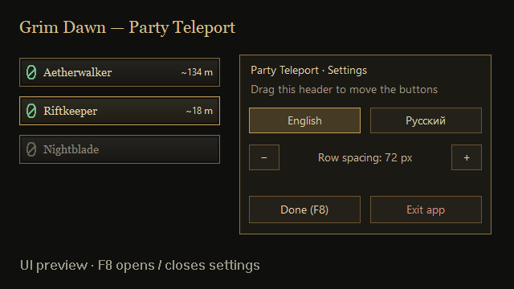

# Grim Dawn — Party Teleport

[English](README.md) · [Русский](README.ru.md)

[](https://github.com/Tor-del/GrimDawn-PartyTeleport/actions/workflows/build.yml)

Teleport to a teammate using a small button beside your party portraits. Attaches to an already running **Grim Dawn x64** in the normal campaign. No Custom Game selection is needed.

**Experimental:** automated tests pass, but live multiplayer teleportation, host/client synchronization and compatibility with other injected mods remain unverified. Buttons are external overlay windows, positioned manually rather than integrated into native portrait widgets.



*Rendered UI preview with example names and distances; not a multiplayer screenshot.*

## Installation

1. Download **Setup-x64.exe** from [Releases](https://github.com/Tor-del/GrimDawn-PartyTeleport/releases).
2. Run Setup; it locates Steam libraries and verifies the supported game DLLs. Leave **Create a desktop shortcut** selected.
3. Start **Grim Dawn x64** through Steam, then open **Grim Dawn — Party Teleport** on your desktop or in the Start menu.
4. Join a party, adjust the button position with F8, and click the button bearing your teammate's name.

The shortcut attaches to the running game. If it is closed, the app asks you to start it. Use **windowed or borderless** mode; exclusive fullscreen may hide external overlays. Close Grim Dawn and Party Teleport before upgrading/uninstalling a loaded module. First-time installation is possible while the game is open.

Portable ZIP: extract into the Grim Dawn installation directory, preserving `mods/PartyTeleport/`, then open `Launch-PartyTeleport.cmd` in the game directory. Do not extract into `x64`.

## Controls and languages

| Key | Action |
| --- | --- |
| F8 | Open/close settings mode |

Press **F8** while the game is active to open the settings panel. Select **English** or **Русский**, drag the panel header (or a placeholder row) to move the whole button column, and use **− / +** or the mouse wheel to change row spacing. **Exit app** closes Party Teleport. Press F8 again or click **Done (F8)** to hide settings; only teammate teleport buttons remain. Teleport requests are disabled during setup. Holding F8 does not repeatedly toggle the mode. The former F9–F12 shortcuts have been removed.

English is the default for Setup and the app, regardless of Windows language. Russian can be selected explicitly. Setup passes the selected language to its main shortcut. Separate **Party Teleport (English)** and **Party Teleport (Русский)** Start menu shortcuts are included. The language buttons remember your preference until a shortcut explicitly selects a language again.

Settings: `%LOCALAPPDATA%\GrimDawnPartyTeleport\PartyTeleport.ini`. No administrator rights are needed to save them. Run the game and app at the same privilege level.

Original dark bronze buttons, serif lettering and green rift icons are inspired by Grim Dawn; no game artwork, fonts or textures are bundled. Names identify the destination: engine player order may differ from portrait order. Default position X=230, Y=150, row spacing=72 pixels; adjust with F8 for your UI scale.

## Distances and teleport rules

- `~134 m` is an **approximate straight-line 3D distance**, assuming one world-coordinate unit is one metre. This scale has not been calibrated in a live game; it is not walking distance.
- Distance is shown only for positions in the **same loaded region**. Otherwise it is omitted. Teleport availability is checked separately.
- You must be alive, not already teleporting, and allowed by the game to use a personal teleport. There is a three-second cooldown between calls to the native teleport function.
- Party membership, destination and request age are checked again in the game's update thread. Requests older than one second are discarded. Special-area restrictions are not bypassed.
- Native teleport coordinates are integers, truncated toward zero. A return portal is not created separately.

The module uses the game's native teleport activity and adds no custom multiplayer transport. Whether the host needs the mod, cross-area transitions and remote-client outcomes require live testing. CoopDPS, TwitchChat and Camera10xFPS compatibility is also unverified: some hook the same update function. F8 is the only shortcut used by Party Teleport; it may conflict with another mod using the same key.

## Supported game

Windows 10/11, x64 only. The installer and DLL require these exact SHA-256 hashes:

```text
Game.dll   cd7ecd7942d719f96b42aff4896f8c25d52152b4a41191f71a4a66ea48cecad2
Engine.dll 4c2ea14ce1c591b315cc29a8a96819a5c3c7e194adbd6f7eea208b9bb8a93153
```

Game updates may need a mod update. Game executables, databases and saves are not patched on disk. The injected DLL remains in memory until Grim Dawn exits; the game performs normal saves after movement.

## Build and test

Install Visual Studio C++ Build Tools (x64 compiler and Windows SDK) and [Inno Setup 6](https://jrsoftware.org/isinfo.php). From the repository root:

```powershell
.\Build.ps1 -StageOnly
.\Build-Installer.ps1 -SkipBuild -CompilerPath 'C:\Program Files (x86)\Inno Setup 6\ISCC.exe'
.\Test-Installer.ps1
.\Package.ps1 -SkipBuild
```

Binaries and tests: `build/`. Installer, ZIP and `SHA256SUMS.txt`: `installer/dist/`. `-StageOnly` leaves installed copies untouched; without it, Build also tries to copy binaries beside the source. `VERSION` controls package filenames. Build-Installer can locate a standard Inno Setup installation automatically.

Hidden-window UI tests also cover the F8 toggle, setup-only actions, language persistence, movement, spacing limits, no teleport during setup, Done and Exit. Tests exercise the actual bridge with mocked engine calls: party changes, native arguments, cooldown, invalid/expired requests, restrictions, positions, distances, cross-region suppression and translations. Installer tests cover English defaults, Russian selection and unsupported targets before installation. Optional local locked-file check: `Test-Installer.ps1 -GameRoot 'C:\path\to\Grim Dawn'`. CI requires no game files; none are distributed in this repository.

| Application option | Purpose |
| --- | --- |
| `--language en` / `--language ru` | Select language |
| `--check` | Verify game hashes without attaching |
| `--preview` | Show example buttons without attaching |
| `--render-preview C:\preview.bmp` | Render an example UI image without attaching |
| `--attach-check` | Load the module and check its state without teleporting |

Attachment and `--check` require `<game>/mods/PartyTeleport/`. Preview modes work from `build/`.

## GitHub Actions

The Windows workflow builds and tests on pushes to `main`, pull requests and manual runs. It installs checksum-verified Inno Setup 6.7.3, builds Setup and the portable ZIP, and uploads artifacts. It never installs or launches Grim Dawn.

A successful push to `main` publishes an **experimental prerelease** for `VERSION` if it does not exist. Existing release assets are never overwritten. For a new release, update `VERSION`, `source/app.rc` and `docs/release-notes.md`, then push to `main`. Pull requests and manual runs only build artifacts. The release job needs its scoped `contents: write` permission.

## Removal and credits

Uninstall through **Windows Settings → Apps → Grim Dawn — Party Teleport**. User settings are kept. For portable installs, close the game/app and remove `mods/PartyTeleport/` and `Launch-PartyTeleport.cmd`.

Project: [MIT](LICENSE). [MinHook](https://github.com/TsudaKageyu/minhook) and its disassembler retain their [license notices](vendor/minhook/LICENSE.txt). Native signatures were cross-checked against [Riftgate Companion](https://github.com/elmodor/grimdawn-riftgatecompanion); its code is not bundled. Grim Dawn belongs to Crate Entertainment. This is an unofficial community project.
