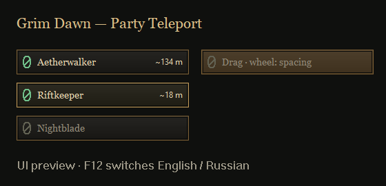

# Grim Dawn — Party Teleport

[English — основной README](README.md) · [Русский](README.ru.md)

Кнопки рядом с портретами группы для телепортации к товарищам. Мод подключается к уже запущенной **Grim Dawn x64**, работает в обычной кампании и не требует Custom Game.

**Экспериментальная версия:** автоматические проверки пройдены. Работа в живой группе, синхронизация хоста/клиента и совместимость с другими модулями ещё не подтверждены. Кнопки — отдельные окна поверх игры, положение настраивается вручную.



*Отрисованный пример с демонстрационными именами и расстояниями, а не снимок сетевой игры.*

## Установка

1. Скачайте **Setup-x64.exe** из [Releases](https://github.com/Tor-del/GrimDawn-PartyTeleport/releases).
2. Запустите установщик: он найдёт библиотеки Steam и проверит DLL игры. Оставьте включённым создание ярлыка.
3. Запустите **Grim Dawn x64** через Steam, затем ярлык **Grim Dawn — Party Teleport** на рабочем столе или в меню «Пуск».
4. Войдите в группу, расположите кнопки через F9 и нажмите кнопку с именем нужного товарища.

Ярлык подключается к открытой игре; если она закрыта, приложение предложит её запустить. Нужен **оконный режим или окно без рамки**. Перед обновлением или удалением загруженного мода закройте Grim Dawn и приложение. Первая установка возможна при открытой игре.

Переносимую ZIP-версию распакуйте в корень Grim Dawn с сохранением `mods/PartyTeleport/`, затем откройте `Launch-PartyTeleport.cmd`. Распаковывать в `x64` не нужно.

## Управление и языки

| Клавиша | Действие |
| --- | --- |
| F9 | Настройка: перетаскивайте кнопку для сдвига столбца, колесо меняет шаг строк |
| F10 | Закрыть приложение |
| F11 | Скрыть/показать кнопки |
| F12 | English / Русский |

Английский — основной язык, независимо от языка Windows. Русский выбирается явно. Установщик передаёт выбранный язык главному ярлыку. В меню «Пуск» есть отдельные **Party Teleport (English)** и **Party Teleport (Русский)**. Выбор F12 сохраняется до следующего запуска ярлыка с явным указанием языка.

Настройки: `%LOCALAPPDATA%\GrimDawnPartyTeleport\PartyTeleport.ini`. Для сохранения права администратора не нужны. Игра и мод должны работать с одинаковыми правами.

Оформление: тёмные кнопки, бронзовая рамка, шрифт с засечками и зелёный разлом. Графика, текстуры и шрифты игры не включены. Порядок кнопок может отличаться от портретов — ориентируйтесь на **имя**. Начальные X=230, Y=150, шаг=72 пикселя. F9 позволяет настроить положение под масштаб интерфейса.

## Расстояния и ограничения

- `~134 м` — **приблизительное расстояние по прямой в 3D**. Принято допущение «единица мировых координат = метр»; масштаб ещё не откалиброван в живой игре. Это не длина пешего пути.
- Расстояние видно только при известных позициях в **одной загруженной области**. Иначе число скрывается. Доступность телепорта проверяется отдельно.
- Персонаж должен быть жив, не телепортироваться; игра должна разрешать личный портал. Между вызовами штатной функции — задержка 3 секунды.
- Состав группы, точка и возраст запроса проверяются повторно в игровом потоке. Запросы старше секунды отбрасываются. Ограничения особых областей не обходятся.
- Штатная функция принимает целые координаты с округлением к нулю. Обратный портал отдельно не создаётся.

Мод использует штатную активность телепортации без собственного сетевого протокола. Нужен ли он хосту, как работают переходы между областями и удалённый клиент — предстоит проверить. Совместимость с CoopDPS, TwitchChat и Camera10xFPS не подтверждена: некоторые перехватывают ту же функцию. F6–F8 оставлены им; F12 может одновременно вызывать действие Steam/игры.

## Совместимость

Windows 10/11, только x64. Требуются точные SHA256:

```text
Game.dll   cd7ecd7942d719f96b42aff4896f8c25d52152b4a41191f71a4a66ea48cecad2
Engine.dll 4c2ea14ce1c591b315cc29a8a96819a5c3c7e194adbd6f7eea208b9bb8a93153
```

Обновление игры может потребовать обновления мода. Файлы игры, база и сохранения не патчатся на диске. DLL остаётся в памяти до выхода; обычные сохранения после перемещения делает игра.

## Сборка и GitHub

Нужны Visual Studio C++ Build Tools x64 с Windows SDK и Inno Setup 6:

```powershell
.\Build.ps1 -StageOnly
.\Build-Installer.ps1 -SkipBuild -CompilerPath 'C:\Program Files (x86)\Inno Setup 6\ISCC.exe'
.\Test-Installer.ps1
.\Package.ps1 -SkipBuild
```

Бинарные файлы/тесты — `build/`. Установщик, ZIP и `SHA256SUMS.txt` — `installer/dist/`. `-StageOnly` оставляет установленную копию без изменений. Без него Build также пробует скопировать бинарные файлы рядом с исходниками. Версия пакетов задаётся в `VERSION`.

Тесты проверяют настоящий обработчик с подменёнными функциями движка: состав группы, вызовы, задержки, устаревшие запросы, ограничения, позиции, расстояния и языки. Проверки установщика охватывают английский по умолчанию, русский и неподдерживаемые DLL. Локальная проверка занятой DLL: `Test-Installer.ps1 -GameRoot 'C:\путь\к\Grim Dawn'`. В CI файлы игры не нужны и не публикуются.

Параметры приложения: `--language en`, `--language ru`, `--check` (хеши без подключения), `--preview` (пример кнопок), `--render-preview C:\preview.bmp` (отрисовка примера), `--attach-check` (подключение без перемещения). Для подключения/`--check` нужна структура `<игра>/mods/PartyTeleport/`; пример работает из `build/`.

GitHub Actions собирает проект при push в `main`, pull request и ручном запуске. Проверяет SHA256 Inno Setup 6.7.3, запускает тесты и создаёт установщик/ZIP. Успешный push в `main` создаёт **экспериментальный предварительный релиз** версии из `VERSION`, если его ещё нет. Файлы существующих релизов не перезаписываются. Для новой версии измените `VERSION`, `source/app.rc` и `docs/release-notes.md`. Pull request и ручной запуск создают только артефакты.

## Удаление и лицензии

«Параметры Windows → Приложения → Grim Dawn — Party Teleport». Настройки сохраняются. Переносимую версию удаляют после закрытия игры и приложения: `mods/PartyTeleport/` и `Launch-PartyTeleport.cmd`.

Код проекта — [MIT](LICENSE), MinHook — по собственной [лицензии](vendor/minhook/LICENSE.txt), включая уведомления дизассемблера. Сигнатуры сверялись с [Riftgate Companion](https://github.com/elmodor/grimdawn-riftgatecompanion); его код не включён. Grim Dawn принадлежит Crate Entertainment. Проект неофициальный.
